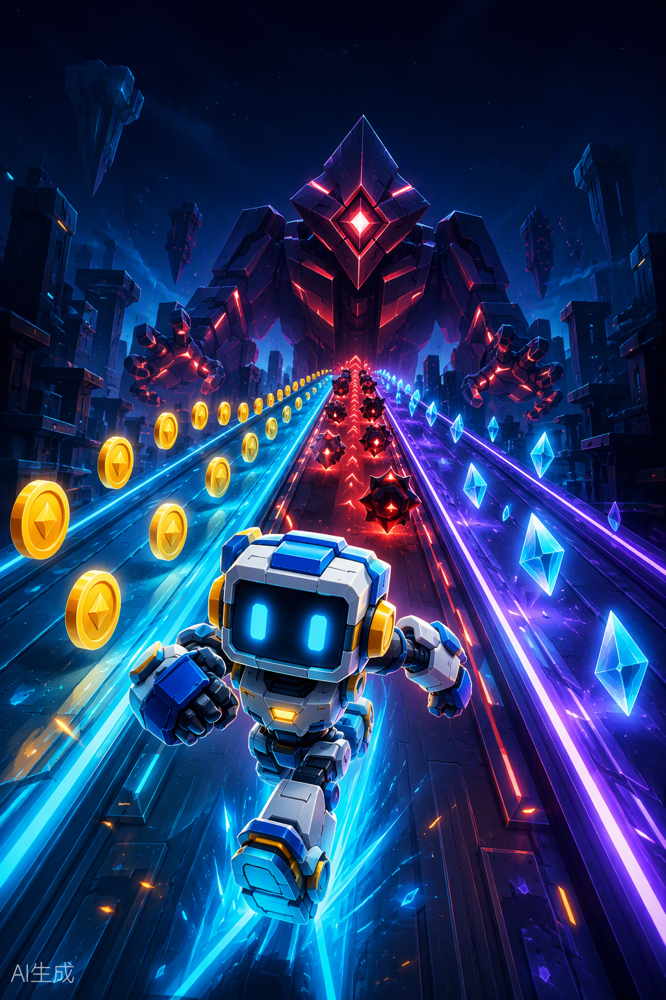

[简体中文](README.zh_CN.md) | **English**

# Robo Dash

An offline three-lane runner for the FoloToy AI Passport. Guide a small robot through an obstacle course, collect coins by touching them, choose routes, and defeat the final guardian.



## Highlights

- Three-stage run with continuous obstacle patterns and recovery gaps.
- Contact-based coin collection, combos, and a rechargeable Overload ability.
- Shield and Rush pickups; no magnet or automatic coin collection.
- Safe, Normal, and Risk route choices during the run.
- Three-hit guardian encounter with lane-aligned attack warnings and counterattack windows.
- Three lives, a persistent high score, sound effects, and a native desktop simulator.
- Fully offline gameplay: no Wi-Fi, Bluetooth, account, voice enrollment, or network service is required.

## Controls

The device has three buttons. Up and Down map to left and right movement.

| Input | Action |
| --- | --- |
| Up | Move one lane left |
| Down | Move one lane right; exit from pause or a result screen |
| OK | Start or restart; jump while running; resume while paused |
| Double-click OK | Activate Overload when energy is full |
| Hold OK | Pause while running |

The desktop simulator uses Left/Right arrows to change lanes, Space to jump, X to activate Overload, P to pause, and Esc to quit.

## How to play

1. Press OK to start. Change lanes to avoid blocks and barriers, or jump over obstacles when appropriate.
2. Touch coins to collect them. Coins charge Overload; consecutive pickups increase the combo reward.
3. Collect Shield to absorb a collision and Rush for a temporary advantage. There is no coin magnet.
4. When a route prompt appears, use the lane-change controls to choose Safe, Normal, or Risk before the window closes.
5. Fill energy to 100%, then double-click OK to trigger Overload. During the guardian encounter, dodge the red lane warnings and use Overload during a counterattack window.
6. Finish the course and defeat the guardian to win. The best score is stored in NVS when storage is available.

## Hardware and software

- FoloToy AI Passport with ESP32-C3 and 8 MB flash
- ESP-IDF 5.5.3
- 240 x 320 color display
- Three device buttons
- Optional audio output for game sound effects

The game uses a pure C logic core, a single LVGL Canvas playfield, and separate game and render tasks. The simulator compiles the same `main/runner_game.c` core as the firmware.

## Build and validate

Activate ESP-IDF 5.5.3, then run the complete repository gate:

```bash
source <path-to-esp-idf-v5.5.3>/export.sh
idf.py --version
./tools/validate.sh
```

The gate runs repository checks and host tests, builds from the tracked defaults in an isolated directory, verifies the configured flash layout, and produces:

```text
build/FoloToy-AI-Passport-full.bin
```

This merged image is the release artifact and is flashed at offset `0x0`. Flashing a merged image may reset NVS data, including the saved high score. Do not substitute the application-only `build/FoloToy-AI-Passport.bin`.

For incremental development only:

```bash
idf.py set-target esp32c3
idf.py build
idf.py -p <PORT> flash monitor
```

See [Build and Test](docs/development/engineering/build-and-test.md) and [Firmware Layout](docs/development/engineering/firmware-layout.md) for validation, flashing, stored-data, and debugging-artifact details.

## Desktop simulator

Requirements: a host C compiler and Python 3 with Tk 8.6 or newer (Tk 9 recommended).

```bash
# Compile the C core and run checks without opening a window.
python3 simulator/run.py --check

# Run the interactive simulator.
python3 simulator/run.py

# Rebuild the shared C library explicitly.
python3 simulator/run.py --rebuild

# Open, exercise, and close an automated UI smoke test.
python3 simulator/run.py --ui-smoke
```

On macOS, you can also open `simulator/play.command`. It searches common Python 3 commands and selects one with a compatible Tk runtime; it does not depend on a machine-specific Python path.

Simulator scores and build products are written under the Git-ignored `build/simulator/` directory.

## Source layout

```text
main/main.c             Device input, audio, HUD, NVS, and tasks
main/runner_game.c/.h   Pure gameplay logic and collision geometry
main/runner_world.c/.h  Single-Canvas LVGL playfield renderer
simulator/              Native Tk simulator and launcher
tests/test_runner_game.c
tools/validate.sh       Complete build and host-test gate
```

## Notes

- This branch replaces the template demo menu with a dedicated game interface.
- Gameplay does not require networking, cloud services, voice recognition, or a microphone.
- A successful build or simulator test is not a substitute for on-device testing.
- Generated firmware, local scores, Python caches, and debug bundles are not committed.

## License

This project is distributed under the repository's [MIT License](LICENSE).
